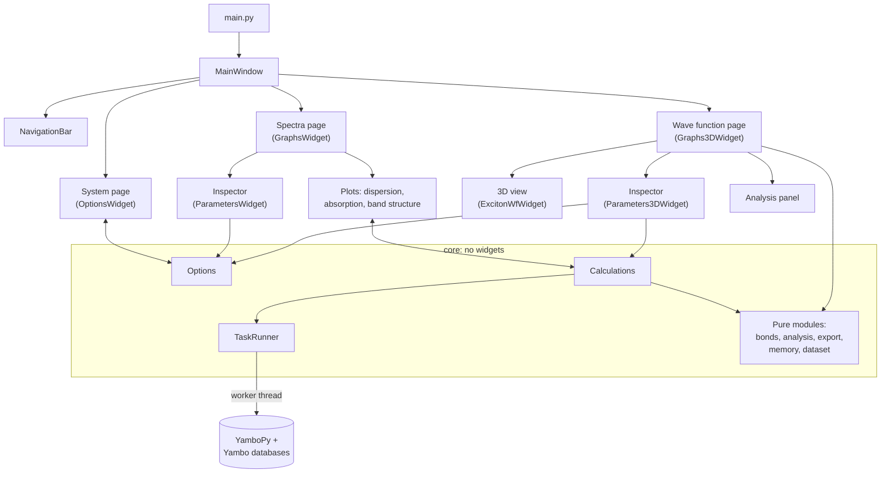
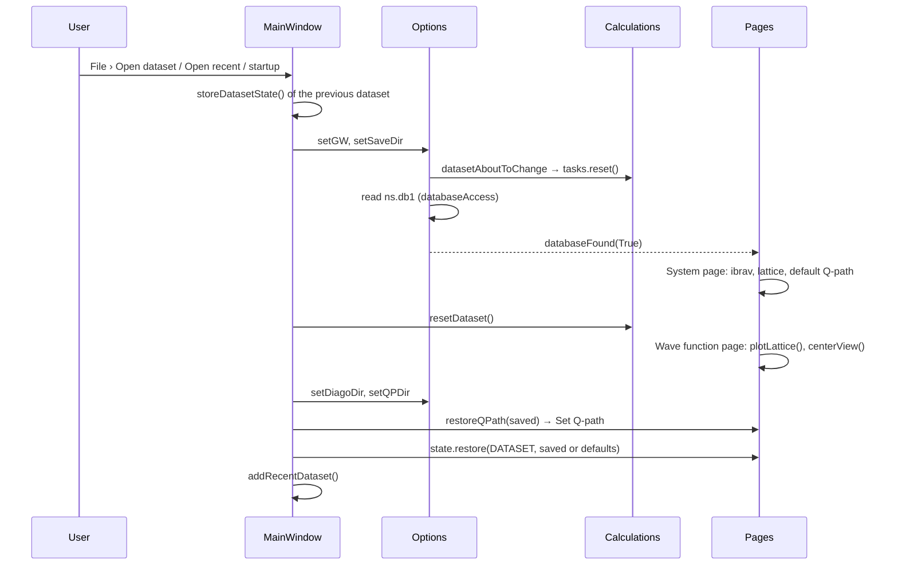
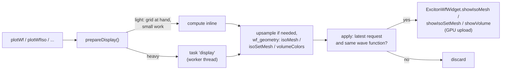

# Visual Excitons: architecture and developer guide

This document explains how Visual Excitons is built: where things live, how data flows from the Yambo databases to the plots, and the conventions and pitfalls you need to know before changing it. The user documentation is the [README](../README.md); this is for developers.

Contents:

1. [Overview](#1-overview)
2. [Repository layout and names](#2-repository-layout-and-names)
3. [Architecture at a glance](#3-architecture-at-a-glance)
4. [Core layer](#4-core-layer)
5. [Background calculations](#5-background-calculations)
6. [Data flows, step by step](#6-data-flows-step-by-step)
7. [Units, coordinates and indices](#7-units-coordinates-and-indices)
8. [3D rendering](#8-3d-rendering)
9. [GUI framework](#9-gui-framework)
10. [Recipes](#10-recipes)
11. [Testing](#11-testing)
12. [Pitfalls and lessons learned](#12-pitfalls-and-lessons-learned)
13. [Known limitations and ideas](#13-known-limitations-and-ideas)

---

## 1. Overview

Visual Excitons is a desktop application to explore excitonic properties computed with [Yambo](https://www.yambo-code.eu/): excitonic dispersion, absorption spectra, excitonic band structure, and the real-space wave function of excitons.

Stack:

| Layer | Library | Used for |
|---|---|---|
| GUI | PySide6 (Qt 6), as `PySide6-Essentials` (the full `PySide6` adds about 400 MB of unused add-ons) | Windows, widgets, signals, threads, settings |
| 2D plots | PyQtGraph | Dispersion, absorption, band structure, analysis plots |
| 3D plots | PyQtGraph OpenGL (`pyqtgraph.opengl`) + PyOpenGL | Crystal structure, isosurfaces, volume |
| Data | YamboPy, from the fork [jmcastelo/yambopy](https://github.com/jmcastelo/yambopy), branch `ase-bz` | Reading Yambo databases, BSE quantities, real-space wave functions |
| Numerics | NumPy, SciPy | Everything numerical |
| System | psutil (optional) | Available memory, cross-platform |

The fork's `ase-bz` branch provides the `BrillouinZone` class and the `get_lattice_data` / `IBRAV_REQUIRED_PARAMETERS` helpers used for Bravais lattices and Q-paths, and a patch to `ExcitonDispersion` (marked "Commented by JMC") needed by this app.

It is a regular Python package (`pyproject.toml`, version in `visual_excitons/__init__.py`): `pip install -e ".[test]"` for development, then run `visual-excitons`, `python -m visual_excitons` or `python visual_excitons/main.py` (the last one puts the repository root on `sys.path` itself). Tests: `pytest` (see [Testing](#11-testing)). See the README for installation, including working on the YamboPy fork alongside.

---

## 2. Repository layout and names

```
visual_excitons/
├── __init__.py             __version__
├── __main__.py             python -m visual_excitons
├── main.py                 main(): QApplication, OpenGL context sharing, MainWindow (the visual-excitons command)
├── core/                   No widgets: data, calculations, pure numerics
│   ├── options.py          Options: the user's parameters and the lattice/Q-path state
│   ├── calculations.py     Calculations: all Yambo calculations, as background tasks
│   ├── tasks.py            TaskRunner: worker thread, progress, cancellation, DB lock
│   ├── dataset.py          Finding SAVE / BSE / GW directories in a folder
│   ├── bonds.py            Bond detection in periodic crystals
│   ├── analysis.py         Plane cuts, distance distribution, upsampling
│   ├── export.py           Cube / XSF writers
│   ├── memory.py           Real-space grid and memory estimates
│   ├── atomic_data.py      Symbols, covalent radii, Jmol colors, Bohr/Å constants
│   └── style.py            Style objects of the 2D plots (pens, symbols, axes, legend)
├── gui/                    Widgets and rendering
│   ├── main_window.py      MainWindow: menus, status bar, pages, datasets, persistence
│   ├── navigation_bar.py   Left sidebar with painted icons
│   ├── theme.py            System / Light / Dark themes, plot colors
│   ├── inspector.py        Side panel framework: collapsible sections, forms, notes
│   ├── persistence.py      Values kept between sessions (global and per dataset)
│   ├── options_widget.py   System page
│   ├── graphs_widget.py    Spectra page (its three plots + inspector)
│   ├── parameters_widget.py       Spectra page inspector
│   ├── dispersion_widget.py       ┐
│   ├── absorption_widget.py       ├ The three 2D plots
│   ├── band_structure_widget.py   ┘
│   ├── style_widget.py     "Appearance" editor of the 2D plots
│   ├── highlight.py        Ring around the selected exciton
│   ├── graphs_3d_widget.py Wave function page: orchestrates 3D view, inspector, analysis
│   ├── parameters_3d_widget.py    Wave function page inspector
│   ├── exciton_wf_widget.py       The 3D view (GLViewWidget subclass)
│   ├── wf_geometry.py      Isosurface meshes and volume colors (pure functions)
│   ├── sorted_mesh_item.py Translucent mesh drawn back to front
│   ├── volume_item.py      Volume colors/opacity and half-float volume item
│   ├── atom_labels_item.py Atom symbols as depth-tested 3D labels
│   ├── axes_3d_widget.py   Axes gizmo, cell parameters
│   ├── gl_style.py         Draw stages, GL options, shaders, sphere/cylinder meshes
│   ├── colormaps.py        Colormaps of the density
│   ├── analysis_widget.py  Analysis panel (plane cut, distance distribution)
│   └── image_export.py     Image export of the 3D view
tests/                      pytest suite (see Testing)
docs/                       This document
data/                       Test datasets (not in the repository)
```

**Historical names.** Some classes kept their original names after the GUI was reorganized into pages. The mapping:

| Class | File | What it is now |
|---|---|---|
| `OptionsWidget` | `options_widget.py` | The **System** page |
| `GraphsWidget` | `graphs_widget.py` | The **Spectra** page |
| `ParametersWidget` | `parameters_widget.py` | The Spectra page's side panel (inspector) |
| `Graphs3DWidget` | `graphs_3d_widget.py` | The **Wave function** page |
| `Parameters3DWidget` | `parameters_3d_widget.py` | The Wave function page's side panel |
| `ExcitonWfWidget` | `exciton_wf_widget.py` | The 3D view |
| `Options` | `core/options.py` | Parameters and lattice state, not only "options" |

---

## 3. Architecture at a glance



The rules behind this structure:

- **`core` has no widgets.** `Options` and `Calculations` are `QObject`s (for signals), but they know nothing about windows. Pure computations (bonds, plane cuts, exports, memory estimates) are plain functions taking arrays, testable without Qt.
- **The GUI talks to `core` through signals and slots.** `Calculations` emits results; pages connect them to plots. Most wiring happens in the page constructors and in `MainWindow`.
- **One `Options` and one `Calculations`** exist, created by `MainWindow` and passed to the pages.
- **Slow work runs in a worker thread** through `TaskRunner` (section 5): the GUI never blocks on Yambo databases or heavy numerics.

---

## 4. Core layer

### `Options` (`core/options.py`)

Holds the user's parameters and the lattice state:

- Data directories (`saveDir`, `diagoDir`, `qpDir`), calculation type (`gw`), number of Q-points (`nQpoints`).
- Lattice: `cell` (lattice vectors, rows, Bohr), `latticeParameters`, `ibrav`, `variant`, high-symmetry points, the Q-path `qBZ` (a yambopy `BrillouinZone`) and extra points.
- Parameters of the calculations and displays (energies, exciton count, fixed particle positions, supercell, cutoff, iso levels, opacities, atom/bond sizes...).
- View directions: `viewBases`, `viewPresets` and `viewVectorToCartesian()`.

Key signals: `saveDirChanged`, `diagoDirChanged`, `qpDirChanged`, `databaseFound(bool)`, `numQPointsChanged(int)`, `gwChanged(bool)`, and `datasetAboutToChange`, emitted **before** a new SAVE directory is read (it cancels calculations on the old dataset).

`setLatticeData()` clears the Q-path and extra points, which belong to the previous lattice.

Setters clamp values (e.g. energies) rather than raising; widgets read the clamped value back.

### `Calculations` (`core/calculations.py`)

Every Yambo-based calculation, as **compute functions** (module level, pure: they use only their arguments) and **methods** that snapshot inputs, submit a task and apply results:

| Method | Compute function | Result signals |
|---|---|---|
| `getExcitonDispersion()` | `computeDispersion` | `qPathReady`, `excitonDispersionRange`, `excitonDispersionNumCurvesChanged`, `excitonDispersionInit` (then the style replots via `emitExcitonDispersionReady`) |
| `computeQPointAbsorptionSpectrum(points, toggle)` | `computeAbsorption` | `excitonAbsorptionCurveAppended/Removed`, `excitonAbsorptionReady` |
| `recomputeAbsorptionSpectra()` | `computeAbsorption` (each curve) | `excitonAbsorptionReady` |
| `getExcitonBandStructure(points, _)` | `computeBandStructure` | `excitonBandStructureNumCurvesChanged/Init/Ready` |
| `computeExcitonWaveFunction(...)` | `computeWaveFunction` | `wfComputed` |
| `exportDensity(filename)` | `export.writeDensity` | `densityExported(str)` |

Other responsibilities:

- **Exciton selection**, shared by the pages: `selectExciton` (absorption point: energy is x) and `selectDispersionExciton` (dispersion point: energy is y) set `selectedExciton = (qIndex, excIndex, energy)` and emit `excitonSelected`. `selectedExcitonPositions()` gives where to draw the highlight ring.
- **Size estimates**: `estimateWaveFunction()` returns the grid and memory of a wave-function calculation (see `core/memory.py`), reading only what it needs; it never blocks on the database lock (returns `None` if busy).
- **Wave-function geometry**: `wfVoxels()`, `wfFixedCrystal()`, `wfFixedCartesian()`, `wfSupercellAtoms()`, used by analysis and export.
- **Caches**: `lattice`, `wavefunctionCache` (the loaded `YamboWFDB`, the slowest thing to load, one at a time), `planeWaves`, `excitonSizes`. `resetDataset()` clears them and the results.
- **Progress/error signals**, forwarded from the `TaskRunner`: `busyStarted(str)`, `busyFinished()`, `busyChanged(bool)`, `progressChanged(done, total, stage)`, `taskCancelled(str)`, `errorOccurred(title, message)`.

Absorption curve bookkeeping: `excAbsData` is a list of dicts, one per curve, with `'fixed'` telling whether the curve was kept (Ctrl-click). Curves and the curve styles in `AbsorptionStyle` are parallel lists: always remove by index, going backwards (see `_updateAbsorptionCurves`).

### Pure modules

| Module | Main functions | Notes |
|---|---|---|
| `bonds.py` | `findBonds(lattice, positions, numbers, tolerance)`, `halfBonds(...)` | Covalent-radius criterion with periodic images; each atom draws its half of each bond |
| `analysis.py` | `planeCut`, `planeAxes`, `planeSupercellPolygon`, `atomsNearPlane`, `radialDistribution`, `upsampleDensity`, `voxelVectors`, `gridPositions` | Trilinear interpolation (SciPy), truncation indicator `boundary` |
| `export.py` | `writeCube`, `writeXsf`, `writeDensity`, `supercellAtoms` | Vectorized writers; scientific notation |
| `memory.py` | `PlaneWaves.fftBox(cutoff)`, `estimateMemory`, `chooseBlockSize`, `availableMemory` | Grid as yambopy computes it; memory from array shapes |
| `dataset.py` | `findDataset`, `datasetName`, `datasetExists` | BSE/GW searched next to the SAVE directory only |
| `atomic_data.py` | `chemical_symbols`, `covalent_radii` (Å), `jmol_colors`, `BOHR_TO_ANGSTROM`, `ANGSTROM_TO_BOHR` | From ASE |
| `style.py` | `DispersionStyle`, `AbsorptionStyle`, `BandStructureStyle` | State of the 2D plot styles; edited by `style_widget.py` |

---

## 5. Background calculations

All of it is in `core/tasks.py`.

### The compute / apply split

A task has two parts:

```python
self.tasks.submit(message,
                  compute=lambda context: computeSomething(context, **snapshot),  # worker thread
                  apply=self._applySomething,                                     # GUI thread
                  key='something')
```

- **`compute(context)`** runs in the worker thread, on a **snapshot** of its inputs taken when submitting. It must not touch shared state (`self.xxx` of `Calculations`, `Options`, widgets) and must not emit signals. It returns a result.
- **`apply(result)`** runs in the GUI thread: it stores the result and emits signals.

Results go from the worker to the GUI through a `_Relay` QObject's signals (queued connections).

### Rules

- **One task at a time**, in submission order (`QThreadPool` with one thread, plus the runner's own queue). This is also what keeps netCDF/HDF5 safe: those libraries must not be used from two threads at once.
- **`DATABASE_LOCK`** (reentrant) is held by the worker while computing. Database reads from the GUI thread go through `databaseAccess()` (blocks until the running task ends) or `DATABASE_LOCK.acquire(blocking=False)` (never blocks; used by the estimates).
- **Keys**: submitting a task with a `key` drops queued (not started) tasks with the same key, so repeated requests (editing a range several times) run once. `dropPending(key)` drops them explicitly.
- **Generations**: `reset()` (new dataset) cancels everything and increments `generation`; results of tasks submitted before are discarded.
- **Cancellation** is cooperative: `context.check()` raises `Cancelled` if requested. The progress hooks call it, so yambopy loops stop within a fraction of a second.
- **Progress**: `context.stage(label, total)` and `context.advance()`, throttled to 20 signals per second.
- **Synchronous mode**: `Calculations(options, synchronous=True)` runs tasks inline, for tests.

### Progress hooks into yambopy

`installProgressHooks()` replaces, once:

- `tqdm` in `yambopy.dbs.wfdb` and `yambopy.bse.realSpace_excitonwf` by a function that, **inside a task**, returns a progress bar reporting to the task (stage names translated by `STAGE_NAMES`), and outside one returns the real `tqdm`.
- `YamboExcitonDB` in `yambopy.bse.bse_dispersion` by a stand-in counting the databases loaded (one per Q-point, the slow part of the dispersion).

The current task is found through a thread-local `currentContext()`, so the GUI thread is never affected. If yambopy renames these, the hooks fail loudly in `test_tasks.py`.

### Display preparation

The Wave function page uses the same runner for heavy display work (upsampling, isosurfaces, volume colors), see section 8.

---

## 6. Data flows, step by step

### Opening a dataset



`MainWindow.openDataset()` merges what was saved for the same SAVE directory (Q-path, parameters) into the dataset, so opening a folder again through `Open dataset` also restores them.

### From the dispersion to the wave function

1. **Compute dispersion** (Spectra page) → `Calculations.getExcitonDispersion()` → task → `_applyDispersion` stores `qIndices` (path point → Q-point index), points and interpolated curves → signals → `DispersionWidget.plotData`.
2. **Click a dispersion point** → `DispersionWidget.qPointSelected(points, ctrl)` → `computeQPointAbsorptionSpectrum` (absorption at that Q-point), `getExcitonBandStructure`, and `selectDispersionExciton`.
3. **Click a bright exciton** in the absorption → `AbsorptionWidget.excitonsSelected` → `selectExciton` → `excitonSelected(q, exc, energy)`:
   - Spectra inspector: "Selected exciton" section and its button.
   - Wave function inspector: sets the Q-point and exciton spin boxes.
   - `GraphsWidget.updateHighlights`: rings in both plots.
   - `MainWindow`: status bar message.
4. **Compute wave function** (Wave function page) → `Parameters3DWidget.computeWf()`:
   - `confirmMemory()` asks the estimate; asks the user if it likely does not fit; its block size is used.
   - `Calculations.computeExcitonWaveFunction(q_index, exc_index, ..., block_size)` → task `computeWaveFunction` → `_applyWaveFunction` → `wfComputed`.
5. **On `wfComputed`**:
   - `Graphs3DWidget.plotWf()` prepares and shows the current plot type (section 8).
   - `Parameters3DWidget.onWfComputed()` shows the snapped fixed-particle position and grid.
   - The analysis panel recomputes (`onWfComputedForAnalysis`).
   - Export actions are enabled; the size estimate is refreshed.

---

## 7. Units, coordinates and indices

Getting these wrong is the most common source of bugs here.

**Lengths.** Everything inside the program is in **Bohr**, as yambopy reads it: lattice vectors, atomic positions, the wave-function grid, the 3D scene. Everything shown to the user is in **Å** (cell parameters, bond radius, analysis plots, XSF files; cube files are in Bohr by format). Convert with `BOHR_TO_ANGSTROM` / `ANGSTROM_TO_BOHR` from `atomic_data.py`. Covalent radii in `atomic_data.py` are in Å.

**Lattice vectors** are stored as **rows** (`lattice.lat[i]` is vector *i*). Crystal → Cartesian: `positions = crystal @ lattice` (or `lattice.T @ crystal` for one vector).

**Indices.**

| Quantity | Convention | Example |
|---|---|---|
| Q-point index (`qIndex`, `q_index`) | 0-based | file `ndb.BS_diago_Q{qIndex + 1}`; shown as "Q-point {qIndex + 1}" |
| Exciton index (`excIndex`, `exc_index`) | 1-based, in increasing energy | as in yambopy |
| Path point index (`PointData.i`) | 0-based along the Q-path | `qIndices[i]` gives the Q-point |
| Dispersion curve | `PointData.j` = exciton index (1-based) | curve `j - 1` |

**The wave-function grid.**

- yambopy's `ex_wf2Real` makes even supercell sizes odd, snaps the fixed particle to the nearest grid point and moves it to the **central cell** (`supercell // 2`). The app enforces odd sizes in the GUI and reads back the effective values: `wfSupercell`, `wfGrid` (points per cell), `wfFixedPosition` (crystal coordinates in the unit cell), `wfFixedCrystal()` (in the supercell).
- The supercell spans cells `0 … n − 1` along each lattice vector from the origin, as the 3D view draws it.
- Grid point `(i, j, k)` is at `i v1 + j v2 + k v3`, the voxel vectors being supercell vectors divided by the grid size (`wfVoxels()`, `analysis.voxelVectors`). `Calculations.tr4x4` is the same map as a 4×4 transform (voxel vectors as **columns**), used for the 3D items. When upsampling by `f`, divide its 3×3 part by `f`.
- `waveFunction` is the probability density summed over the degenerate states and spins, **normalized to its maximum** (values in [0, 1]).

**View directions** follow VESTA: the direction is from the viewer into the screen. `ExcitonWfWidget.viewRotation()` builds the quaternion; pyqtgraph's `opts['rotation']` is **world → camera**.

---

## 8. 3D rendering

### The 3D view (`exciton_wf_widget.py`)

`ExcitonWfWidget` subclasses `gl.GLViewWidget` in quaternion rotation mode, and overrides:

- `projectionMatrix()`: a **true orthographic** projection (the default), with the same apparent scale as the perspective one, so zoom and pan keep working.
- `paint()`: forces `glDepthMask(GL_TRUE)` before clearing (see pitfalls).
- `renderImage(width, height, transparent)`: renders off screen at any size (used by image export).

It owns the items: atoms (one merged sphere mesh per cell), bonds (one merged cylinder mesh), cell boundaries (lines), atom labels, the fixed particle, the density plots (`wfMeshItem`, `wfMeshItemSet`, `wfVolItem`), the analysis cut plane, the cell-parameter overlay (a `QLabel`) and the axes gizmo (a child `AxisGizmo`).

### Draw order and blending (`gl_style.py`)

PyQtGraph draws items by increasing depth value:

| Stage | Value | Items | GL options |
|---|---|---|---|
| `OPAQUE_STAGE` | 0 | Atoms, bonds, lines | Depth test and write, no blending |
| `LABEL_STAGE` | 0.5 | Atom labels | Depth test, blending, alpha discard |
| `TRANSLUCENT_STAGE` | 1 | Isosurfaces, volume, cut plane | Depth test, **no depth write**, blending |

Translucent blending uses `glBlendFuncSeparate(SRC_ALPHA, ONE_MINUS_SRC_ALPHA, ONE, ONE_MINUS_SRC_ALPHA)`: color blended with alpha, alpha accumulating coverage. Anything blending must use this form (see pitfalls).

Multisampling (4×) is requested with `enableMultisampling(widget)` before the widget is shown.

Shaders: `headlightShader` (light from the viewer, ambient + specular) for opaque items and single isosurfaces; `litEdgesShader` (softer, more opaque at silhouettes) for isosurface sets. Both are pyqtgraph `ShaderProgram`s.

Meshes: `spheresMeshData` and `cylindersMeshData` build many spheres/cylinders as one mesh, with exact normals given through `PrecomputedNormalsMeshData` (pyqtgraph's own normal computation is a slow Python loop).

### Translucent meshes (`sorted_mesh_item.py`)

`SortedMeshItem` draws its triangles back to front, re-sorting only the index buffer when the camera has moved (checked in `paint()`, so any camera change is covered). Orthographic: sort by view depth (one dot product per face); perspective: by distance to the eye. Meshes above `LARGE_MESH` faces are re-sorted at most every `SORT_INTERVAL` while the camera moves, and once more when it stops.

### Density plots: geometry off the GUI thread



- `wf_geometry.py` computes the geometry as pure functions: isosurfaces with **vectorized normals**, isosurface sets as a single mesh (so faces of all levels are sorted together), volume colors.
- `Graphs3DWidget.prepareDisplay()` decides inline or background (`INLINE_DISPLAY_WORK`), caches the upsampled density (`displayCache`, one copy), and only shows the result of the **latest request** (`displayRequest`) for the current wave function. The shown plot stays until its replacement is ready.
- `ExcitonWfWidget.plotWf*()` remain as synchronous wrappers (compute + show).

### Volume (`volume_item.py`)

`volumeRGBA()` treats the density as an absorbing medium (Beer–Lambert), with opacity calibrated on the densest line of sight and corrected for the number of slices; `FloatVolumeItem` uploads a half-float 3D texture (8 bits would round the tiny per-slice alphas to zero).

### Atom labels (`atom_labels_item.py`)

`AtomLabelsItem` draws the chemical symbols as textured quads on the front of each atom, billboarded in a shader and depth-tested like any object (hidden behind other atoms).

### Axes gizmo (`axes_3d_widget.py`)

`AxisGizmo` is a small transparent `GLViewWidget` child, synced to the main view's rotation. Arrow sets (Cartesian, lattice, reciprocal) are each scaled to fit. It clears to **transparent black**. Labels are `GLTextItem`s.

### Image export (`image_export.py`)

`composeImage()` renders the scene with `renderImage()` (multisampled framebuffer object at the requested size), then composites the gizmo (a temporary hidden `AxisGizmo` at scale, its labels painted by Qt at their projected positions) and the cell-parameter label (vector painting). Transparent renders clear to transparent black. This relies on **OpenGL context sharing** (`AA_ShareOpenGLContexts`, set in `main.py`).

---

## 9. GUI framework

### Main window (`main_window.py`)

`MainWindow` creates `Options`, `Calculations`, the 2D styles, the three pages in a `QStackedWidget`, the `NavigationBar`, menus, status bar (dataset label, task label, progress bar, Cancel), the theme, and the persistence registry. It handles datasets (open, recent list, Q-path and parameter restore), exports, errors (`QMessageBox`) and saving state on close.

### Side panels (`inspector.py`)

Every page's side panel is an `Inspector` (a `QScrollArea`) made of `CollapsibleSection`s:

```python
form = formLayout()
form.addRow('Label:', widget)
form.addRow(NoteLabel('Explanation...'))      # spans both columns
section = self.addSection('Title', form, expanded=False)
self.remember('key', widget)                  # kept between sessions
...
self.alignLabels()                            # once, at the end of the constructor
```

- `formLayout()`: the form conventions (left-aligned labels, growing fields).
- `alignLabels()`: gives all form labels the same width, and sets the panel's minimum width to its widest section (`updateMinimumWidth`), so nothing is cut off.
- `NoteLabel`: small explanatory text that wraps correctly in forms and follows the theme.
- `ValueSlider`: slider with its value shown beside it.
- `pageLayout(view, inspector)`: the page layout, with the inspector in a splitter on the right.

Rows shown only for some plot types use `QFormLayout.setRowVisible` (`Parameters3DWidget.plotTypeRows`).

### Themes (`theme.py`)

`themeManager()` (one per application) applies `System` (the platform style and palette), `Light` or `Dark` (Fusion with custom palettes) and emits `themeChanged(dark)`. Plot colors come from `PLOT_COLORS[dark]`; `plotForeground()` gives the current foreground for plot items. Widgets that paint themselves connect to `themeChanged` (e.g. `NavigationBar`, `NoteLabel`, pages' `setDarkTheme`). The application's palette-change events are not reliable for this; use the signal.

### Persistence (`persistence.py`)

Values kept between sessions are registered with a **scope**:

- `GLOBAL`: user preferences (display, view, layout), saved in the settings as one JSON blob under `state`.
- `DATASET`: parameters of a system (energy range, exciton, fixed particle positions, supercell, cutoff...), saved with each dataset in `recentDatasets`.

Each panel has a `PersistentState`; `MainWindow` collects them in a `StateRegistry` under prefixes (`spectra`, `spectraLayout`, `wavefunction`, `wavefunctionLayout`). Values are restored **by setting the widgets**, in registration order, so they go through the same code as a user edit. `afterRestore` hooks apply what widgets don't apply by themselves. Values that must be restored together (e.g. the energy range, whose bounds clamp each other) are registered as one entry with custom `get`/`set`.

A dataset opened for the first time gets the defaults (`MainWindow.datasetDefaults`), not the previous dataset's values.

Settings (`QSettings('VisualExcitons', 'VisualExcitons')`):

| Key | Content |
|---|---|
| `geometry`, `page`, `theme`, `showInspector` | Window |
| `state` | JSON: global values of all panels |
| `recentDatasets` | JSON list: directories, `gw`, `qPath`, `state` (dataset values) |
| `exportDir` | Last export folder |
| `imageExport/*` | Last image export choices |

---

## 10. Recipes

### Add a control to a side panel

1. Create the widget in the right `build…Section` of the inspector and add it to the section's form.
2. Connect it to an `Options` setter and/or a signal of the inspector; connect that signal in the page constructor.
3. If it should be kept between sessions: `self.remember('key', widget, scope)`; choose `DATASET` if it depends on the system.
4. Add a test in `tests/test_gui.py`, and to `test_persistence.py` if remembered.

### Add a slow calculation

1. Write a compute function at module level in `calculations.py` (or a pure module), taking a `context` and plain arguments; report `context.stage(...)` / `context.advance()` in loops.
2. Add a method in `Calculations` that validates (and calls `self._reject(message, reason)` on bad input), snapshots its inputs, and submits with an `apply` method that stores results and emits signals. Give it a `key` if repeated requests should replace each other.
3. Test it with `Calculations(options, synchronous=True)` and fakes (see `test_core.py`), and end to end in `test_workflow.py` if it needs real data.

### Add something to the 3D scene

- Opaque: `OPAQUE_GL_OPTIONS`, `OPAQUE_STAGE`, `headlightShader`, exact normals.
- Translucent: `TRANSLUCENT_GL_OPTIONS`, `TRANSLUCENT_STAGE`; a `SortedMeshItem` if it can overlap itself.
- Anything blending: `glBlendFuncSeparate` as above, never plain `glBlendFunc`.
- Make it follow the theme if it has colors on the background (`setDarkTheme`).
- Check it in an exported image, opaque and transparent (`tests/render_checks.py`).

---

## 11. Testing

```
pytest                    # fast tests (about 20 s), no display needed
pytest -m slow            # end-to-end calculations on data/BiI3_Bulk_8x8x8
pytest -m "slow or not slow"
```

Configuration in `pyproject.toml`; shared setup in `tests/conftest.py`:

- Qt runs on the **offscreen** platform (unless `QT_QPA_PLATFORM` is set), and settings go to a temporary directory: tests never touch the user's settings.
- `datasetPath(name)` and the `lattice` fixture skip tests whose dataset in `data/` is missing (`data` marker).
- OpenGL context sharing is enabled as in `main.py`.

Files: `test_bonds`, `test_rendering` (meshes, normals, volume opacity, cell parameters, colormaps), `test_analysis`, `test_memory`, `test_core` (datasets, options, selection, absorption curves), `test_tasks` (threading, hooks), `test_export`, `test_persistence`, `test_gui` (the window, offscreen), `test_workflow` (slow, real data).

**OpenGL rendering cannot be tested offscreen**: Qt's offscreen platform has no OpenGL, and showing an OpenGL widget there crashes the process. Rendering checks live in `tests/render_checks.py`, run by `test_export.py` in a **separate process on the display** (Wayland or X11, matching the session), and are skipped without one.

Tips:

- Use `Calculations(..., synchronous=True)` for logic tests; real threads only in `test_tasks.py` and a few GUI tests (`qtbot.waitSignal`, `qtbot.waitUntil`).
- Fake data must be **complete** (e.g. a fake wave function needs `wfGrid`, `wfSupercell`, `tr4x4`...): slots connected to signals will use it, and pytest-qt reports exceptions raised in slots as test errors. Clean fakes up at the end of a test: theme changes at teardown replot.
- Anything creating a `QPixmap`/`QImage` from widgets needs the Qt application: request the `qapp` or `qtbot` fixture.
- Make each test file pass **alone** too (`pytest tests/test_x.py`).
- Memory-heavy runs on real data: cap them (`prlimit --as=...`) and start small (see pitfalls).

---

## 12. Pitfalls and lessons learned

**PyQtGraph OpenGL**

- `opts['rotation']` is world → camera. `cameraPosition()` is wrong in quaternion mode, and its rotation → euler conversion is unreliable: compute directions from the quaternion (`viewRotation`, `cameraAxes`).
- `glClear` respects the depth mask: translucent items leave depth writes off, so `paint()` must turn them on before clearing, or opaque items vanish on the next frame.
- `MeshData` caches face-indexed vertices once normals are computed, after which `GLMeshItem` switches to non-indexed drawing on any re-parse, which cannot be sorted: `SortedMeshItem.parseMeshData` drops that cache.
- `MeshData.vertexNormals()` is a Python loop: seconds for large meshes. Provide normals (`PrecomputedNormalsMeshData`, `wf_geometry.vertexNormals`).
- A `GLTextItem` paints with `QPainter` on the widget, not into framebuffer objects: it is missing from off-screen renders and fringed on transparent ones.
- Pixel-based sizes (line widths) do not scale with off-screen renders: `renderImage` widens them.

**Alpha and compositing**

- Qt treats OpenGL framebuffers as **premultiplied** alpha: color must not exceed alpha. Clearing to "white with zero alpha" is invalid and overflows into dark fringes when composited. Clear transparent things to `(0, 0, 0, 0)`.
- Blending alpha like color (`glBlendFunc(SRC_ALPHA, ONE_MINUS_SRC_ALPHA)`) makes edges translucent in the final image: use the separate alpha factors.
- When checking images, convert to the right format: `RGBA8888` is straight alpha, `RGBA8888_Premultiplied` premultiplied.

**OpenGL contexts and platforms**

- Resources (shaders, buffers) are only shared between contexts with `AA_ShareOpenGLContexts`, set before creating the `QApplication`. Without it, a separate GL window (the export's gizmo copy) cannot use the shared shaders.
- On a Wayland session PyOpenGL uses EGL; running Qt with `QT_QPA_PLATFORM=xcb` there leaves PyOpenGL without a context. Use the session's platform.

**Threads and databases**

- netCDF/HDF5 are not safe from several threads: all database reads go through the single worker or `DATABASE_LOCK`.
- Never read mutable shared containers being changed by the worker without a snapshot (`list(dict.keys())`).
- PyQtGraph and Qt objects only in the GUI thread: compute functions return arrays, `apply` creates items.

**Memory**

- `YamboWFDB` stores the wave functions as complex128 and briefly holds them twice while loading: about 2.4 GB peak for BiI3 (1.06 GB kept). `computeWaveFunction` frees the previous cached database before loading another.
- `ex_wf2Real` holds a buffer of `block_size` k-points over the grid of a cell for every state and spinor pair: gigabytes for fine grids and degenerate excitons. The block size does not change the result; `memory.chooseBlockSize` fits it to the available memory.
- The development machine has 16 GB: run memory-heavy experiments capped and one at a time.

**Numerics**

- Marching cubes produces zero-area triangles where the surface goes through grid points; their vertices get a default normal.
- Cubic-spline upsampling overshoots slightly: clip to [0, 1].
- Absorption with the default 4–20 eV range missed BiI3's excitons (about 2.2 eV): the automatic range follows each spectrum's excitons.

---

## 13. Known limitations and ideas

- Results (dispersion, spectra, wave function) are not kept between sessions; only parameters are. A disk cache of results keyed by dataset and parameters, camera persistence and named session files were discussed and deferred.
- The 2D plot styles (`style.py`, `style_widget.py`) are older code: not kept between sessions, and theme switching only replaces colors still at their default.
- The excitonic band structure is only available at Γ.
- Boundary atoms (atoms just outside the supercell) and a per-species bond-length table are not implemented.
- Plain `print` output from yambopy goes to the console.
