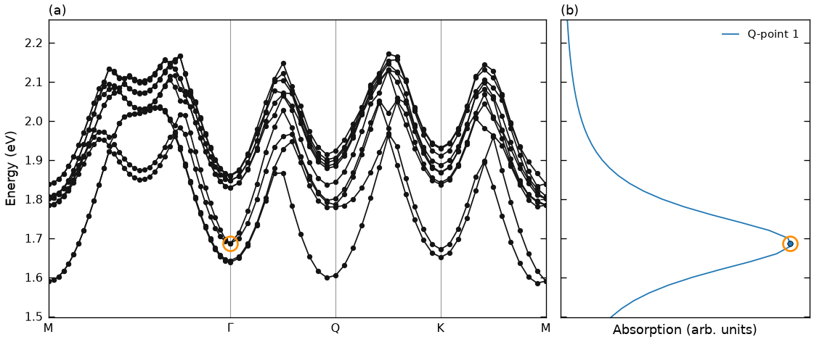
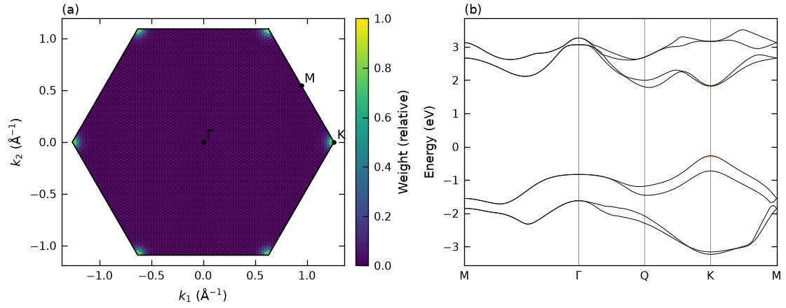
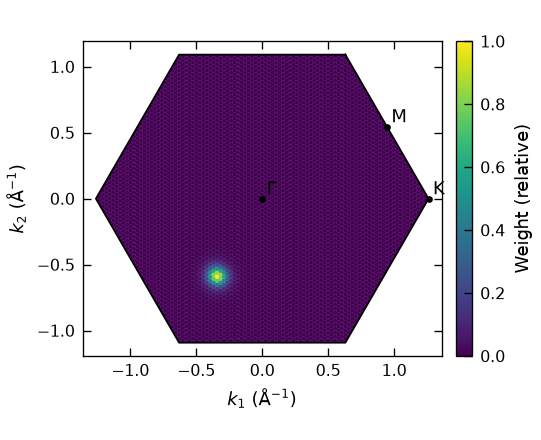
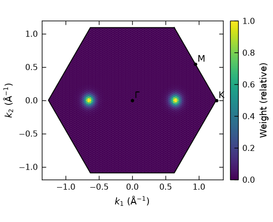
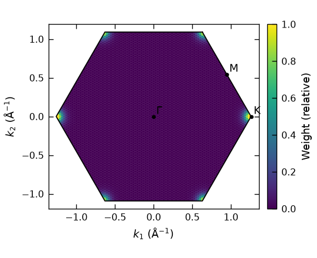
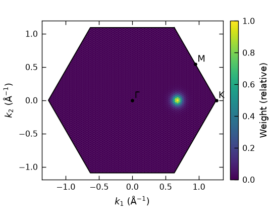
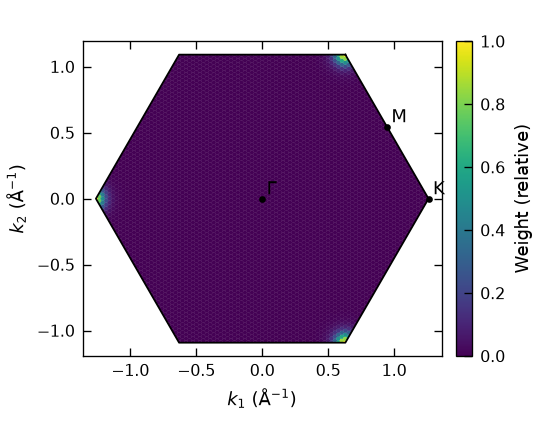

# Validation: monolayer WSe2, Dogadov et al. 2026

[← Documentation](../README.md#documentation)

This page checks the theoretical claims of a published study against Visual Excitons, run on the study's own dataset:

> O. Dogadov, J. Cervantes-Villanueva, N. Olsen, C. Trovatello, X. Zhu, G. Cerullo, A. Molina-Sánchez, D. Sangalli and S. Dal Conte, *Nonequilibrium dynamics of high energy transitions in monolayer WSe2*, J. Phys.: Condens. Matter **38**, 265701 (2026), [doi:10.1088/1361-648X/ae72dc](https://doi.org/10.1088/1361-648X/ae72dc). Data and inputs: [zenodo.org/records/19815236](https://zenodo.org/records/19815236).

The paper explains the slow build-up of the D transition in pump-probe experiments by exciton physics. Optically excited A excitons scatter into momentum-dark excitons at q = Q and q = M. These dark excitons share their hole with A (at K) and their electron with D (in the Q valleys). Its Figures 3 and 4 and their claims come from GW and BSE calculations. Visual Excitons reads the dispersion part of those calculations (`data/WSe2_72x72x1`, not in the repository), so it can check most of them. Each check has a [session](#sessions) to open in the program and see for yourself.

## Summary

| # | Paper's claim (figure) | Visual Excitons | Verdict |
|---|---|---|---|
| 1 | Bright A exciton at about 1.68 eV (Fig. 3a) | Bright doublet (states 3–4) at **1.687 eV**; two dark states below it at 1.638 and 1.643 eV | ✅ agrees |
| 2 | A lies at K/K′ (Fig. 3b) | **99.8 %** of its weight in K/K′, half in each; band pair 62→64 (top valence → second conduction band) | ✅ agrees |
| 3 | Dispersion along M–Γ–Q–K–M with minima at q = Q and q = M below A (Fig. 4a) | **1.590 eV** at M, **1.599 eV** in the Q valley, 1.651 eV at K, 1.638 eV at Γ (dark), A at 1.687 eV | ✅ agrees |
| 4 | Fat bands of A: hole at the valence top at K, electron at the conduction bottom at K (Fig. 4b) | Hole on band 62 at K/K′ (99.7 %), electron on band 64 at K/K′ (99.6 %) | ✅ agrees |
| 5 | Lowest exciton at q = Q: hole at K, electron in a Q valley; it connects K (K′) and Q (Q′) (Fig. 4d) | Hole **99.6 %** in one K valley, electron **99.6 %** in the Q valley on the same side (K′ with Q′ here) | ✅ agrees |
| 6 | Lowest exciton at q = M: hole at K, electron in a Q valley; it connects K (K′) and Q′ (Q) (Fig. 4e) | Hole in K/K′, electron in Q/Q′ (99.6 % each, degenerate pair); each state takes its hole and its electron from opposite sides (K with Q′) | ✅ agrees |
| 7 | A shares its hole state with the q = Q and q = M excitons | Same band (62) and valley in k-space; in real space, hole densities with an overlap of **0.998–0.9998** | ✅ agrees, also in real space |
| 8 | The band gap is indirect | QP bands: valence top at K, conduction bottom in the Q valley, **38 meV** below the K valley. DFT bands: direct at K (Q 40 meV above) | ✅ agrees with GW; it does not hold without it |
| 9 | Absorption peaks B, C, D (Fig. 3a); maps of B, C and D (Fig. 3c–e); D's fat bands and its electron in the Q valleys (Fig. 4c) | The dataset has the lowest 10 states of each Q-point (up to about 1.9 eV at Γ) | ⬜ not testable with this dataset |

Two smaller observations:
- The lowest exciton of all lies slightly off M along M–K (Q106, 1.585 eV), 5 meV below M itself.
- The minimum of the Q valley is at 11/24 of Γ–K (1.599 eV), just short of the midpoint Q = K/2 (1.605 eV), where the paper puts its label.

## The dataset

`data/WSe2_72x72x1` holds the SAVE database (`save`, with the wave functions), the BSE diagonalisations (`diagos_sel`) and the QP corrections (`gw/ndb_WSe2_72x72.QP`). Compared with the paper's inputs on Zenodo (`Theory/QE`, `Theory/Yambo`):

- **The same calculation.** 72×72×1 k-grid, spinors with spin–orbit coupling (`noncolin`, `lspinorb`), a = 6.279 Bohr, 100 Ry wave-function cutoff, BSE bands 59–66 (4 valence, 4 conduction), 2D slab cutoff, RIM-W, and QP corrections for bands 59–66 at all 469 irreducible k-points.
- **Dispersion runs, not the Zenodo BSE input.** The Zenodo `bse.in` is the Γ-only absorption of Fig. 3a, solved with Haydock in coupling mode (`BSEmod= "coupling"`, `BSSmod= "h"`, `BSEQptR` 1–1, 0–5 eV, 30 meV damping). Our databases are resonant (`COUPLING` 0) diagonalisations at 73 Q-points, each keeping its **lowest 10 states**, with screening from bands 1–120 (`BS_W_BANDS`; Zenodo's `screening.in` has 1–80). These are the runs behind Fig. 4a, whose curves stop at 1.9 eV.
- **The computed Q-points are the edge of the irreducible wedge**: Γ→M (Q1–Q37, 36 steps), Γ→K (Q1, Q38, Q73, …, Q469, 24 steps) and M→K (Q37, Q106, …, Q466, 12 steps), the paper's path M–Γ–Q–K–M. The program shows them as a [sparse Q-point set](datasets.md) (points without interpolated curves).
- `data/WSe2/Full_diago`, found next to it, adds nothing. 397 of its 469 files are byte-identical copies of `ndb.BS_diago_Q3`, made by its own `copyfile.sh` (probably to let a tool that wants every Q-point run). The other 72 are the files of `diagos_sel`. Don't use it: the copies would show Q3's excitons at Q-points they don't belong to.

## How it was checked

Three scripts in `validation/dogadov-2026/` call the program's own code:

- `analyse.py` uses the core calculations (`computeComposition`, and the QP energies of the band structure). It reads the BSE and QP databases, not the wave functions, in seconds, and writes `results.json`. Each k-point of the full grid is given to the nearest of Γ, K, K′, Q, Q′ (the midpoints of Γ–K and Γ–K′) and M, with their periodic images. The weights of the [Composition panel](composition.md) are then added up by valley.
- `densities.py` computes the hole and electron densities ([Where the particles of an exciton are](exciton-densities.md)) at 40 Ry (a 15×15×91 grid), and writes `densities.json`. At 10 Ry (9×9×47) every conclusion was the same, with the numbers within 0.01 except the electron overlaps (0.68 instead of 0.57).
- `make_sessions.py` and `make_figures.py` drive the program itself, with temporary settings and kept results, to save the [sessions](#sessions) and draw the figures below with its figure export.

The degenerate states are summed throughout, as the program does by default: each state of a degenerate group is an arbitrary mixture (e.g. of K and K′), so only the whole group has the symmetry of the crystal.

## Results

### 1. Excitons at Γ (Fig. 3a, A only)

| State | Energy (eV) | Intensity (relative) | Band pair |
|---|---|---|---|
| 1, 2 | 1.638, 1.643 | 0 | 62→63 (spin-forbidden: dark) |
| **3, 4** | **1.687** | 1, 0.22 | 62→64 (bright: the **A** exciton) |
| 5–10 | 1.830–1.861 | 0 | |

The A doublet at 1.687 eV matches the calculated A peak of Fig. 3a (about 1.68 eV) and the measured A exciton at 1.70 eV. Below it lie the spin-forbidden dark excitons of tungsten dichalcogenides (49 and 44 meV below). The two states of the doublet differ in intensity because yambo's field is along x and each state is a mixture of K and K′; the doublet as a whole absorbs evenly. B, at 2.08 eV in the paper, is not among the 10 states kept.

This check found a bug in the program. Its absorption spectra listed the bright excitons with YamboPy's `get_excitons`, which pairs the energies of degenerate groups with the intensities of single states, and numbers them from 0 by group. The A peak's points were taken for states 2 and 3, so clicking it selected a dark exciton, and a second bright point appeared at 1.83 eV. The program now lists the states themselves (3 and 4 at 1.687 eV) ([YamboPy issue 22](yambopy-issues.md#22-yambobseabsorptionspectraget_excitons-mixes-up-energies-intensities-and-indices-when-states-are-degenerate)).

### 2. The dispersion (Fig. 4a)



| Q-point | Lowest exciton (eV) | Paper's Fig. 4a (read off the plot) |
|---|---|---|
| Γ (Q1) | 1.638 (dark); A 1.687 | about 1.64 |
| M (Q37) | **1.590** | about 1.59 |
| Q valley (Q323, 11/24 of Γ–K) | **1.599** | about 1.60 |
| Q = K/2 (Q343) | 1.605 | |
| K (Q469) | 1.651 | about 1.65 |
| next to M on M–K (Q106) | 1.585, the lowest of all | |

The minima at q = M and q = Q are 97 and 88 meV below the bright A exciton, and also below the dark ones at Γ: optically excited A excitons can relax into them by emitting phonons, as the paper argues. The shape of the dispersion follows Fig. 4a: a steep rise from Γ, the dip at Q and a shallower one at K along Γ–K, and the deepest minimum at M.

### 3. The A exciton (Fig. 3b, 4b)



99.8 % of A is in the K and K′ valleys, half in each. It is 99.6 % the transition from the top valence band (62) to the second conduction band (64), the spin-allowed one. The fat bands show the hole at the top of the valence band at K and the electron at the bottom of the upper conduction band at K, as in Fig. 4b.

### 4. The lowest dark excitons at q = Q and q = M (Fig. 4d, 4e)

| Electron (k) | Hole (k−Q) |
|---|---|
|  |  |

*The lowest exciton with q in the Q valley (Q323).*

| Exciton | Hole (k−Q) | Electron (k) | Band pair |
|---|---|---|---|
| Lowest, q in the Q valley (Q323) | 99.6 % in one K valley | 99.6 % in the Q valley on the same side of Γ | 62→63 (99.5 %) |
| Lowest, q = Q = K/2 (Q343) | 99.6 % K | 99.6 % Q | 62→63 |
| Lowest, q = M (Q37, states 1–2) | K and K′ (49.7 % each) | Q and Q′ (49.8 % each) | 62→63 (99.3 %) |
| Lowest of all, next to M (Q106) | 99.5 % K | 99.3 % Q′ (the other side) | 62→63 |
| Lowest, q = K (Q469) | 99.7 % K | 99.7 % K′ | 62→63 |

| Electron (k) | Hole (k−Q) |
|---|---|
|  |  |
|  |  |

*Top: the lowest exciton at q = M (Q37, the degenerate states 1–2). Bottom: the lowest of all, next to M (Q106), a single state.*

Both claims hold:
- **q = Q:** the exciton takes its hole from a K valley and its electron from the Q valley between it and Γ.
- **q = M:** it takes its hole from K and its electron from a Q valley on the other side, K with Q′ (as Q106, a single state, shows), as the paper says.

At M the two states are degenerate, the time-reversed pair (K, Q′) and (K′, Q), so the sum shows all four valleys. Which valley is called K and which K′ is a convention (the program labels them by its own special points). What matters is that the hole and the electron sit in valleys whose difference is the exciton's momentum, and they do: the electron's map is the hole's shifted by Q.

Their fat bands (the band structure of sessions 2 to 4) show the hole at the valence top at K, but not the electron. The three corners K of the zone are one point (they differ by reciprocal lattice vectors), but the three Q valleys around Γ are not: they are rotated copies of each other. The electron's Q valley is not the one on the path, so its weight is off the path. The program's note below the band structure says so. The paper's Fig. 4d–e use paths through the valleys involved (K–Q–Γ–Q′–K′).

All these excitons have their hole in the top valence band (62) at K or K′, the same state as the hole of A. Their electron is in the lowest conduction band (63), at the Q valleys for q = Q and q = M.

### 5. The indirect gap

| Band edges (eV) | DFT | QP (GW) |
|---|---|---|
| Valence top (band 62): K / Γ | 0.294 / −0.205 | −0.272 / −0.833 |
| Conduction bottom (band 63): K / Q valley | 1.553 / 1.592 | 1.819 / **1.782** |
| Gap | 1.259, direct at K | **2.054, indirect K→Q** (2.091 at K) |

With the QP corrections the conduction band's minimum moves from K to the Q valley, 38 meV lower: the gap is indirect, as the paper finds, and this is why the q = Q and q = M excitons can lie below A. In DFT the Q valley is 40 meV above K. So the claim depends on the GW corrections (the program uses them when the dataset has a QP database, `GW` in the System panel). The paper also notes that the measured gap, direct or indirect, depends on the substrate and the strain.

### 6. Beyond the paper: the same hole and different electrons in real space

The paper shows the shared hole in k-space. The densities of the hole and of the electron ([Where the particles of an exciton are](exciton-densities.md)) show it in real space: if A and the dark excitons share the hole state, their hole densities must be the same. Their electrons, from different conduction valleys, need not be.

| Exciton | Hole: on W / Se | Hole: `<z²/r²>` around W | Electron: on W / Se | Electron: `<z²/r²>` around W |
|---|---|---|---|---|
| A (Γ, states 3–4) | 71 % / 29 % | 0.16 | 86 % / 14 % | **0.42** |
| Lowest, q in the Q valley (Q323) | 71 % / 29 % | 0.16 | 55 % / 45 % | **0.23** |
| Lowest, q = M (Q37) | 71 % / 29 % | 0.17 | 53 % / 47 % | **0.23** |

| Overlap of the densities (1: the same) | Holes | Electrons |
|---|---|---|
| A and q in the Q valley | **0.9998** | 0.57 |
| A and q = M | **0.998** | 0.57 |
| q in the Q valley and q = M | 0.998 | 0.81 |

Shares: each grid point counted for its nearest atom. `<z²/r²>`: the density-weighted average of z²/r² between 0.3 and 1.3 Å from the W atoms, with z normal to the layer. It is 1/3 for a spherical density, higher for orbitals along z (d_z²) and lower for orbitals in the plane (d_xy, d_x²−y²). Overlap: the normalised scalar product of the two densities over the cell.

- **The holes are the same**, to 0.998–0.9998, and in-plane on W (d_xy, d_x²−y²), the known character of the valence top at K.
- **The electrons differ.** A's electron, at the conduction bottom at K, is on W and out of plane (d_z²), as known for that valley. The electrons of the q = Q and q = M excitons, in the Q valleys, spread almost half onto Se and are less out of plane: the mixed W d and Se p character of the Q valley. The two dark excitons have similar electrons (0.81), the same valley type, unlike A's (0.57).

Seen with sessions 6 to 9 in the [Wave function](wavefunction.md) panel: compare the shapes of the densities in 3D, or their plane cuts in the Analysis panel (`Plane cut` of the particle density).

### 7. The energy window

The C and D maps of Fig. 3c–e sum all the states within ±25 meV and ±50 meV of the peaks, by oscillator strength. The program can now do the same: `Sum an energy window` in the Selected exciton section ([Spectra](spectra.md)). With this dataset it can only be shown around A. ±25 meV around the doublet holds states 3 and 4 only. Weighted by oscillator strength, the map gives K and K′ half and half, as Fig. 3b, the same as summing the degenerate states.

Weighting each state by its own intensity, as first written, gave 73 % K′ and 27 % K, because yambo's two states of the doublet absorb 1 and 0.22 for its field along x. A state of a degenerate group is an arbitrary mixture, so its own intensity is arbitrary too. The group's total intensity is not, so the states of a degenerate group now share it equally ([architecture notes](architecture.md#states-summed-degenerate-groups-and-energy-windows)). This matters for the C and D peaks too, whose states come in K/K′ pairs.

### 8. What could not be checked, and what it would take

- **B, C and D** (2.08, 2.37 and 2.68 eV) and their maps (Fig. 3a, 3c–e), and the **D exciton's** fat bands and electron in the Q valleys (Fig. 4c, the other half of the paper's main claim). These need the BSE at Γ diagonalised up to about 2.8 eV, with the eigenvectors written (`WRbsWF`). The transition space is the same (bands 59–66 on the 72×72 grid, 82 944 transitions), but the run kept 10 states. Such a run would take thousands of states: SLEPc with an energy target, or a full diagonalisation. The program would then show the C and D peaks on the absorption spectrum and their maps with the energy window. Comparing D's electron density with that of the q = Q exciton (as in section 6) would test the paper's claim that they share the conduction states.
- The paper's absorption spectrum (Fig. 3a) is solved in **coupling** mode, ours are resonant. For A this changes little in monolayer TMDs, but the energies need not agree to the meV.

## Sessions

`validation/dogadov-2026/sessions/` holds one session per check, with its results: open it with `File › Open session…` and the results are shown at once. Each one points to `data/WSe2_72x72x1`; elsewhere, the program asks for the dataset's folder. The path M–Γ–Q–K–M uses an extra high-symmetry point, Q = K/2, listed in the System panel.

| Session | What it shows | Where to look |
|---|---|---|
| `1-dispersion-and-A-exciton` | The dispersion (10 excitons), the absorption at Γ, A selected | Spectra: the minima at M and Q; Composition: A in K/K′; band structure: Fig. 4b |
| `2-q-Q-exciton` | The lowest exciton at Q323 | Composition (switch `Particle` between electron and hole): Fig. 4d; the band structure shows the hole |
| `3-q-M-exciton` | The lowest exciton at Q37 (M) | The same: Fig. 4e |
| `4-lowest-exciton-near-M` | The lowest exciton of all, Q106 | One state: K with Q′ |
| `5-energy-window-around-A` | A with ±25 meV by oscillator strength, shaded on the spectrum | The note of the Composition panel: states 3–4, half and half |
| `6-A-hole-density`, `7-A-electron-density` | A's hole and electron densities (40 Ry) | Wave function panel: the particle density; Analysis: its plane cut |
| `8-q-Q-hole-density`, `9-q-Q-electron-density` | The same for the q = Q exciton | Compare with 6 and 7: the same hole, another electron |

The sessions keep the particle density, not the wave function. Compute one (`Compute wave function`) to see where the other particle is for a given position of the fixed one. The wave functions load in about 13 s and take 1.5 GB (3.6 GB at the peak); each density then takes a few seconds.

## Reproducing

```
python validation/dogadov-2026/analyse.py            # results.json: seconds
ulimit -v 12000000
python validation/dogadov-2026/densities.py data/WSe2_72x72x1 40      # densities.json: about a minute
python validation/dogadov-2026/make_sessions.py      # the sessions: a few minutes
python validation/dogadov-2026/make_figures.py       # the figures of this page
```

The scripts take the dataset folder as their first argument (`data/WSe2_72x72x1` by default). They read and write neither your settings nor your kept results.
